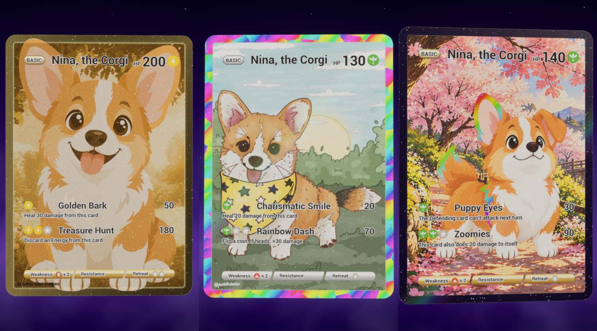
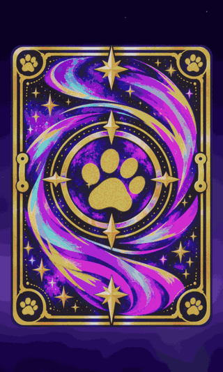
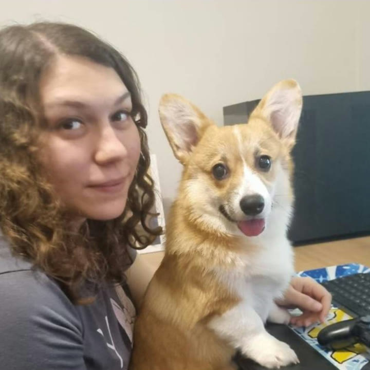

# UnrealGraphicsLab

A personal graphics lab in **Unreal Engine 5.8**, built with C++ and HLSL.

The first experiment is a set of **holographic trading cards** starring Nina, a corgi. Each card has foil, gold, sparkles and parallax, and you can spin it with the mouse in a small showcase.

https://github.com/user-attachments/assets/b20e2937-93ff-4b68-b574-fa66ad048c63

## Highlights

### Card surface
Everything below is procedural, in [`Shaders/Card/Card.ush`](Shaders/Card/Card.ush), unless a painted mask is noted.

**Rainbow holo foil**
- The spectrum shifts with the view angle.
- Optional **Voronoi prism facets** break the bands into crystals.
- **Cracked-ice edges** glint along the facet borders.
- A **pastel** control softens the rainbow.

**Gold**
- A gradient map turns the art's brightness into gold.
- A metallic grain fades into roughness.
- Micro-sparkles sit on top.
- **Engraved concentric rings** ripple the normal.

**Art foil**
- Procedural stars, stripes or diamonds, or a painted mask.

**Mirror metal frame**
- It reflects the purple backdrop instead of the studio HDRI.

**Light effects**
- Sparkles and a moving sheen.
- A soft **glare that follows the mouse** over the card.

**Parallax**
- The foreground character floats above the background, driven by the direction from the card to the camera.

**Layout**
- Rounded-card mask.
- Feathered frame/art seam.
- Full-art option.
- Artist signature stamped as matte ink.

### Card back
- A "makeup multichrome" effect: the swirls' hue slides with the view angle, and painted gold streaks catch the light in turns.
- Gold elements share the front's metallic grain.
- The paw symbol is stamped in the emblem and the four corners.

### Text and data
- Each card is a `UCardData` Data Asset: name, HP, energy type, attacks with energy costs, weakness, resistance and retreat cost.
- A UMG widget (`UCardTextWidget`, written in C++) lays out the text and icons.
- That widget is drawn into a per-card render target, which the material reads as one more layer. The text gets the same lighting as the card.

### Showcase
- **`ACardViewerPawn`:** a fixed camera with drag-to-spin, a pack-opening slide between cards, and zoom.
- **Mouse glare:** a ray-plane intersection turns the mouse position into card UVs, and the glare follows with a small delay.
- **Procedural backdrop** ([`Backdrop.ush`](Shaders/Card/Backdrop.ush)): gradient, glow band, twinkling stars, shooting stars, rising fBm fog and a vignette.
- **Lighting:** a SkyLight with an HDRI cubemap for reflections, Lumen, and manual exposure, so the foil looks the same on every card.

### Cinematics
- **Hero shots** are rendered with **Movie Render Queue**: 1080p60, 8 temporal samples per frame.
- The level sequence is `Cinematics/LS_Card_HeroShots` in `Maps/L_Card_Cinematic`. It has one camera per shot and cards keyed in and out.

## How it is built

Shader math lives in `.ush` files. The material graph only holds parameters, textures and **Custom** nodes that call those functions. The `GraphicsLabShaders` module maps the project's `Shaders/` folder to the `/GraphicsLab` virtual path at startup.

| Path | What is there |
|---|---|
| `Shaders/Shared/Common.ush` | Hashes, value/gradient noise, Voronoi, SDFs, rainbow palettes, hue shift |
| `Shaders/Card/Card.ush` | Card front: layout, foil, gold, sparkles, sheen, glare, final color/roughness/emissive |
| `Shaders/Card/CardBack.ush` | Card back: symbols, metal, multichrome swirls |
| `Shaders/Card/Backdrop.ush` | Showcase backdrop |
| `Source/UnrealGraphicsLab/Card/` | `ACardActor`, `ACardViewerPawn`, `UCardData`, `UCardTextWidget`, `UCardEnergyIconWidget` |
| `Content/GraphicsLab/Card/` | Materials (`M_Card` and one instance per card), Data Assets, Blueprints, UI, maps and cinematics |
| `SourceArt/` | Source images (git-ignored, kept locally) |

## Getting started

**Requirements:**
- Unreal Engine 5.8.
- Visual Studio 2022 with the *Game development with C++* workload.
- [Git LFS](https://git-lfs.com/). Every `.uasset` and `.umap` is stored in LFS.

**Setup:**
1. Clone the repository and run `git lfs pull`.
2. Right-click `UnrealGraphicsLab.uproject` and choose **Generate Visual Studio project files**.
3. Build and open the editor. The project opens in `L_Card_Showcase`.
4. Press **Play**.

| Control | Action |
|---|---|
| Left mouse drag | Spin the card |
| Mouse over the card | Glare |
| Right / Left or D / A | Next / previous card |
| Mouse wheel | Zoom |
| R | Reset the card |

**Rendering the hero shots:**
1. Open `L_Card_Cinematic`.
2. Add `LS_Card_HeroShots` to **Window → Cinematics → Movie Render Queue**.
3. Render with these settings: PNG sequence, 1920×1080, 8 temporal samples, 60 warm-up frames, and Shutter Timing set to **Frame Open**.

## Meet Nina

The cards star Nina, my corgi. Here she is helping me at the desk.

## Art and credits

Several images were generated with AI (ChatGPT): the Nina poses, the card backgrounds and the card back. The cards that use them carry an "AI Generated" stamp.

The bandana corgi and the sunny meadow are original art by Giovana Picolott ([@picolottatelier](https://www.instagram.com/picolottatelier/)), used with permission.

Every third-party asset is listed with its author and license in [CREDITS.md](CREDITS.md).
